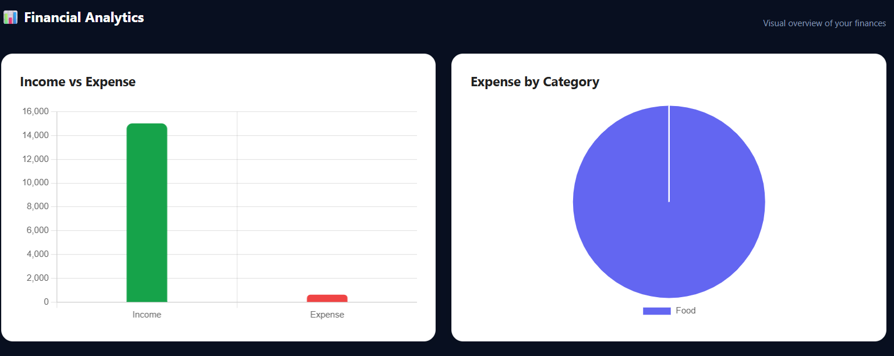
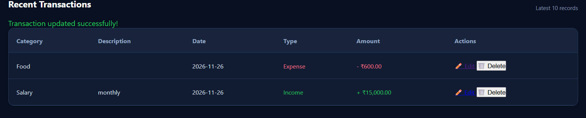

# 💰 Smart Expense Tracker

A web-based **Smart Expense Tracker** built using PHP and MySQL to manage personal income and expenses efficiently.

## 🚀 Features

- User Registration and Login
- Secure User Authentication
- Add Income Transactions
- Add Expense Transactions
- Edit Transactions
- Delete Transactions
- Dashboard with Total Balance
- Income and Expense Summary
- Income vs Expense Bar Chart
- Category-wise Expense Pie Chart
- Recent Transaction History
- MySQL Database Integration

## 🛠️ Technologies Used

- HTML5
- CSS3
- JavaScript
- PHP
- MySQL
- Chart.js
- XAMPP


## 📸 Project Screenshots

### Dashboard


### Financial Analytics


### Transactions


## ⚙️ Installation and Setup

1. Install [XAMPP](https://www.apachefriends.org/).
2. Clone this repository:

   ```bash
   git clone https://github.com/Saurabhbhandari72/Smart-Expense-Tracker.git
   ```

3. Move the project folder into `xampp/htdocs/`.
4. Start Apache and MySQL from XAMPP.
5. Create a MySQL database named `smart_expense_tracker`.
6. Import your database SQL file if available.
7. Configure the database connection in `backend/config.php`.
8. Open the project in your browser:

   `http://localhost/Smart-Expense-Tracker/`

## 🎯 Project Objective

The objective of this project is to provide a simple and user-friendly platform to track income, expenses, and personal financial activities.

## 👨‍💻 Developer

**Saurabh Bhandari**

GitHub: [Saurabhbhandari72](https://github.com/Saurabhbhandari72)

---

⭐ If you like this project, consider giving it a star!